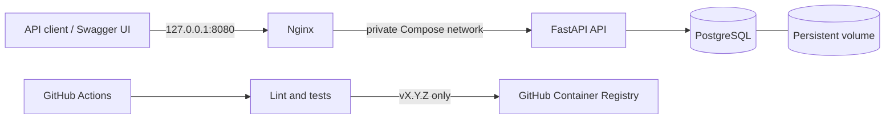

# E-Commerce Product and Order API

A compact, original MVP for the **Cloud Deployment & CI/CD – E-Commerce Platform** assignment. It focuses on the allocated Product and Order API and the delivery work around it: repeatable containers, CI, operations, and recovery.

## What is included

- Searchable product catalog and product details.
- Checkout with stock validation, transactional stock decrement, and price/name/SKU snapshots.
- Required idempotency key with safe exact retries and conflict detection when a key is reused for a different request.
- Token-protected product and stock administration, order status transitions, and persisted audit events.
- Liveness and database readiness endpoints; JSON request logs and request IDs.
- PostgreSQL schema migration, non-root API image, Docker Compose health checks, Nginx reverse proxy, and persistent database volume.
- GitHub Actions lint/test/image workflow. Version tags publish an image to GitHub Container Registry.
- PowerShell backup/restore helpers, runbook, rollback and HTTPS guidance, architecture notes, demo script, and evidence checklist.

The MVP intentionally does not include a storefront UI, payment processing, Kubernetes, or a paid cloud dependency. It demonstrates a reliable backend service that can be deployed on a local machine or small Linux VM.

## Architecture



See [`docs/architecture.md`](docs/architecture.md) for data flow and design choices, and [`docs/operations-runbook.md`](docs/operations-runbook.md) for deployment and recovery instructions.

## Run locally on Windows 11

Prerequisites: Docker Desktop's Linux engine with Compose enabled and running, Git, and PowerShell. The first image build needs internet access to download the base image and Python packages; Python does not need to be installed on Windows when using the Docker test target. If a local Codex session must keep working unattended, keep the computer awake and Docker Desktop running. From this repository folder:

```powershell
Copy-Item .env.example .env
```

Edit `.env` and replace `ADMIN_TOKEN` and `POSTGRES_PASSWORD` with private values before sharing the service. Start the app:

```powershell
docker compose up --build -d
docker compose ps
Invoke-RestMethod http://localhost:8080/health/live
Invoke-RestMethod http://localhost:8080/health/ready
```

The first startup applies the checked-in Alembic migration. The API and database are reachable only inside the Compose network; Nginx is bound to loopback at `http://localhost:8080`. Open [`http://localhost:8080/docs`](http://localhost:8080/docs) for Swagger UI.

Load demo products once:

```powershell
docker compose exec api python -m scripts.seed_demo_data
Invoke-RestMethod 'http://localhost:8080/api/v1/products?q=wireless'
```

Stop the services while keeping the database volume:

```powershell
docker compose down
```

Avoid `docker compose down -v` unless you intentionally want to delete the local database volume.

## API quick tour

| Method | Path | Purpose |
|---|---|---|
| GET | `/api/v1/products?q=...&category=...` | Search active products |
| GET | `/api/v1/products/{id}` | Product details |
| POST | `/api/v1/orders` | Create order; requires `Idempotency-Key` |
| GET | `/api/v1/orders/{id}` | Read order status and price snapshots |
| POST | `/api/v1/admin/products` | Add product; requires admin token |
| PATCH | `/api/v1/admin/products/{id}` | Update product fields or absolute stock count |
| PATCH | `/api/v1/admin/orders/{id}/status` | Confirm, ship, deliver, or cancel an order |
| GET | `/api/v1/admin/audit-events` | Inspect admin audit events |
| GET | `/health/live`, `/health/ready` | Process liveness and database readiness |

Example order body:

```json
{
  "customer_email": "buyer@example.com",
  "items": [{ "product_id": 1, "quantity": 2 }]
}
```

Use a stable key for retries, such as `order-demo-0001`. If the same key is sent with a different order body, the service returns `409 Conflict`. Checkout rejects unavailable or insufficient stock without leaving a partial order. Cancelling a pending or confirmed order returns reserved stock.

Admin calls use `X-Admin-Token` and optional `X-Admin-Actor`. The local `.env.example` values are for a private demo only. Keep real secrets out of Git and recordings.

## Test and lint

The unit/API suite uses SQLite so it can run without Docker or a separate database. It covers health, catalog search/details, auth/audit, stock rejection, price snapshot, idempotency replay/conflict, and cancellation stock recovery.

```powershell
py -3.12 -m venv .venv
.\.venv\Scripts\Activate.ps1
python -m pip install -e ".[dev]"
ruff check app tests migrations
pytest
```

The SQLite suite does not prove PostgreSQL row-lock behavior under concurrent requests. The deployed Compose stack uses PostgreSQL and should also be smoke-tested before submission.

If you do not have Python installed, the optional Docker test target runs lint and tests in a temporary image:

```powershell
docker build --target test -t ecommerce-product-order-api:test .
```

## CI and versioned images

Pull requests and pushes to `main` run lint, tests, and a container build. Push a semantic version tag such as `v1.0.0` to publish version, commit SHA, and `latest` tags to GitHub Container Registry. The first package may be private by default; grant the VM's GitHub account package pull access or make the package public if appropriate.

For a local VM deployment, follow the release steps in the runbook, set `IMAGE_NAME` and `IMAGE_TAG` in `.env`, then `docker compose pull api` and `docker compose up -d --no-build api`. Use the same procedure with the previous image tag for rollback. The included CI workflow does not SSH into an unconfigured VM or store deployment credentials.

## Backup, restore, HTTPS, and recovery

PowerShell helpers are in `scripts/backup.ps1` and `scripts/restore.ps1`. Restore requires the explicit `-ConfirmRestore` switch because it replaces matching database objects. The service's Compose health checks gate startup, the database volume survives normal container replacement, and the runbook describes restart/recovery, version rollback, and a host-Nginx/Certbot HTTPS setup for a Linux VM.

## GitHub submission commands

After you create an empty repository under your own GitHub account, run these from this project folder and replace the example remote with your repository URL:

```powershell
git init
git add .
git commit -m "Build e-commerce product and order API"
git branch -M main
git remote add origin https://github.com/YOUR-USERNAME/YOUR-REPOSITORY.git
git push -u origin main
git tag v1.0.0
git push origin v1.0.0
```

These commands are prepared for you; no GitHub repository is created and no push is performed here.

## Assignment integrity and AI disclosure

This project was assembled with ChatGPT assistance. Review the code, run the demo, and make sure you can explain the design and tradeoffs in your own words. If the assignment form asks which AI tools were used, disclose ChatGPT accurately according to the form. No detector-evasion or authorship claim is made.

## Project files

```text
app/                 FastAPI routes, schemas, SQLAlchemy models, logging
migrations/          Versioned PostgreSQL schema
tests/               Self-contained API tests
deploy/nginx/        Reverse proxy configuration
scripts/             Entrypoint, demo seed, PowerShell backup/restore
.github/workflows/   Lint, test, image build, release tagging
docs/                Architecture, runbook, demo script, evidence checklist
```
