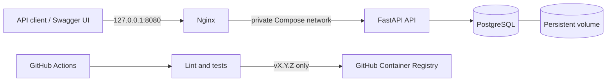

# E-Commerce Product and Order API

A compact, original MVP for the **Cloud Deployment & CI/CD – E-Commerce Platform** assignment. It focuses on the allocated Product and Order API and the delivery work around it: repeatable containers, CI, operations, and recovery.

## What is included

- Searchable product catalog and product details.
- Checkout with stock validation, transactional stock decrement, and price/name/SKU snapshots.
- Required idempotency key with safe exact retries and conflict detection when a key is reused for a different request.
- Token-protected product and stock administration, order status transitions, and persisted audit events.
- Liveness and database readiness endpoints; JSON request logs and request IDs.
- PostgreSQL schema migration, non-root API image, Docker Compose health checks, Nginx reverse proxy, and persistent database volume.
- GitHub Actions lint/test/image workflow. Version tags publish an image to GitHub Container Registry.
- PowerShell backup/restore helpers, runbook, rollback and HTTPS guidance, architecture notes, demo script, and evidence checklist.

The MVP intentionally does not include a storefront UI, payment processing, Kubernetes, or a paid cloud dependency. It demonstrates a reliable backend service that can be deployed on a local machine or small Linux VM.

## Architecture



See [`docs/architecture.md`](docs/architecture.md) for data flow and design choices, and [`docs/operations-runbook.md`](docs/operations-runbook.md) for deployment and recovery instructions.

## Run locally on Windows 11

Prerequisites: Docker Desktop's Linux engine with Compose enabled and running, Git, and PowerShell. The first image build needs internet access to download the base image and Python packages; Python does not need to be installed on Windows when using the Docker test target. If a local Codex session must keep working unattended, keep the computer awake and Docker Desktop running. From this repository folder:

```powershell
Copy-Item .env.example .env
```

Edit `.env` and set a unique random `ADMIN_TOKEN` and `POSTGRES_PASSWORD` before starting the stack. Compose intentionally stops with an error while either value is blank. If a value contains `$`, use single quotes in `.env` to prevent Compose interpolation. Keep `.env` private; only `.env.example` belongs in Git. Start the app:

```powershell
docker compose up --build -d
docker compose ps
Invoke-RestMethod http://localhost:8080/health/live
Invoke-RestMethod http://localhost:8080/health/ready
```

The first startup applies the checked-in Alembic migration. The API and database are reachable only inside the Compose network; Nginx is bound to loopback at `http://localhost:8080`. Open [`http://localhost:8080/docs`](http://localhost:8080/docs) for Swagger UI.

### Configuration and ports

| Variable | Required/default | Purpose |
|---|---|---|
| `POSTGRES_PASSWORD` | Required, no fallback | PostgreSQL password; keep private |
| `ADMIN_TOKEN` | Required, no fallback | Protects admin routes; keep private |
| `POSTGRES_DB` | `ecommerce` | Database name |
| `POSTGRES_USER` | `ecommerce` | Database user |
| `HTTP_PORT` | `8080` | Host loopback port for Nginx |
| `IMAGE_NAME` | `ecommerce-product-order-api` | API image name for local or VM deployment |
| `IMAGE_TAG` | `local` | API image version selected by Compose |
| `LOG_LEVEL` | `INFO` | API log verbosity |

| Listener | Exposure | Purpose |
|---|---|---|
| `127.0.0.1:${HTTP_PORT}` → Nginx `80` | Host loopback only | Client and Swagger access |
| API `8000` | Compose network only | Nginx to FastAPI |
| PostgreSQL `5432` | Compose network only | FastAPI to database |

Load demo products once:

```powershell
docker compose exec api python -m scripts.seed_demo_data
Invoke-RestMethod 'http://localhost:8080/api/v1/products?q=wireless'
```

Stop the services while keeping the database volume:

```powershell
docker compose down
```

Avoid `docker compose down -v` unless you intentionally want to delete the local database volume.

## API quick tour

| Method | Path | Purpose |
|---|---|---|
| GET | `/api/v1/products?q=...&category=...` | Search active products |
| GET | `/api/v1/products/{id}` | Product details |
| POST | `/api/v1/orders` | Create order; requires `Idempotency-Key` |
| GET | `/api/v1/orders/{id}` | Read order status and price snapshots |
| POST | `/api/v1/admin/products` | Add product; requires admin token |
| PATCH | `/api/v1/admin/products/{id}` | Update product fields or absolute stock count |
| PATCH | `/api/v1/admin/orders/{id}/status` | Confirm, ship, deliver, or cancel an order |
| GET | `/api/v1/admin/audit-events` | Inspect admin audit events |
| GET | `/health/live`, `/health/ready` | Process liveness and database readiness |

Example order body:

```json
{
  "customer_email": "buyer@example.com",
  "items": [{ "product_id": 1, "quantity": 2 }]
}
```

Use a stable key for retries, such as `order-demo-0001`. If the same key is sent with a different order body, the service returns `409 Conflict`. Checkout rejects unavailable or insufficient stock without leaving a partial order. Cancelling a pending or confirmed order returns reserved stock.

Admin calls use `X-Admin-Token` and optional `X-Admin-Actor`. The local `.env.example` values are for a private demo only. Keep real secrets out of Git and recordings.

## Test and lint

The unit/API suite uses SQLite so it can run without Docker or a separate database. It covers health, catalog search/details, auth/audit, stock rejection, price snapshot, idempotency replay/conflict, and cancellation stock recovery.

```powershell
py -3.12 -m venv .venv
.\.venv\Scripts\Activate.ps1
python -m pip install -e ".[dev]"
ruff check app tests migrations
ruff format --check app tests migrations
pytest
python -m pip install "pip-audit==2.10.1"
pip-audit .
```

The SQLite suite does not prove PostgreSQL row-lock behavior under concurrent requests. The live Compose stack was checked for health, Swagger, catalog search/details, admin authentication, validation, and migration state. Order creation and idempotency were exercised in a separate SQLite tmpfs container so the existing assignment database was not changed. PostgreSQL concurrent checkout remains untested.

If you do not have Python installed, the optional Docker test target runs lint and tests in a temporary image:

```powershell
docker build --target test -t ecommerce-product-order-api:test .
```

## CI and versioned images

Pull requests and pushes to `main` run lint, tests, and a container build. Push a semantic version tag such as `v1.0.0` to publish version, commit SHA, and `latest` tags to GitHub Container Registry. The first package may be private by default; grant the VM's GitHub account package pull access or make the package public if appropriate.

The workflow also audits Python dependencies and scans the built image for high and critical OS or library vulnerabilities. Publishing permission is confined to the version-tag job. GitHub Actions must run in the target repository to produce a pipeline URL and published image digest.

The configured CI Trivy policy ignores findings without a vendor fix and contains one version-specific, expiring exception for a setuptools 70.3.0 base-layer record that is absent from the final runtime filesystem. The fresh strict scan is a separate full scan with unfixed findings included: it returned exit code 1 with 208 findings, including 47 HIGH Debian runtime findings without a fixed version listed. See the complete classification in `docs/verification-report.md` and `docs/evidence/trivy-image-scan-rebuilt-classification.csv`.

For a local VM deployment, follow the release steps in the runbook, set `IMAGE_NAME` and `IMAGE_TAG` in `.env`, then `docker compose pull api` and `docker compose up -d --no-build api`. Use the same procedure with the previous image tag for rollback. The included CI workflow does not SSH into an unconfigured VM or store deployment credentials.

### Rollback procedure

Before each release, record the current known-good `IMAGE_TAG` and create a database backup. If the new image fails its health check, set `IMAGE_TAG` back to the recorded value, then run `docker compose pull api`, `docker compose up -d --no-build api`, and verify `/health/ready`. For a compatible database schema, this rolls back the application image while preserving the database volume. Schema migrations are forward-only here: restore a database backup only after checking compatibility and confirming the target database, since restore replaces matching objects.

## Backup, restore, HTTPS, and recovery

PowerShell helpers are in `scripts/backup.ps1` and `scripts/restore.ps1`. Restore requires the explicit `-ConfirmRestore` switch because it replaces matching database objects. `scripts/test-backup-restore.ps1` performs a disposable PostgreSQL tmpfs rehearsal; it does not use the assignment database. The reverse-proxy failure/recovery check is `scripts/failure-recovery-check.ps1`. The service's Compose health checks gate startup, and the runbook describes restart/recovery, version rollback, and a host-Nginx/Certbot HTTPS setup for a Linux VM.

## Latest local verification

The no-cache Docker test target passed Ruff lint/format, all 10 API tests, and both pip-audit checks. The production API image rebuilt and the Compose API, PostgreSQL, and Nginx services reported healthy. Live and isolated smoke checks, the Nginx recovery drill, the tmpfs PostgreSQL backup/restore rehearsal, and actionlint workflow validation passed. Their output is saved under `docs/evidence/`.

The fresh strict Trivy scan against the rebuilt API image failed its high/critical gate with exit code 1 and 208 findings: 48 HIGH, including 47 Debian runtime entries with no fixed version listed and one setuptools layer-history finding with a fix listed. The full scan includes unfixed findings; see the JSON and CSV evidence linked from `docs/verification-report.md`. The earlier local CI-policy scan result is separate and does not change this strict-scan failure. No GitHub-hosted workflow, registry image, public HTTPS endpoint, screenshot, or demo recording exists yet. See `docs/assignment-compliance-checklist.md` and `docs/verification-report.md` before submission.

## GitHub submission commands

This project is already a local Git repository on branch `main`; no remote is configured. After choosing the account, repository name, and visibility, add that specific remote and publish only when you are ready:

```powershell
git remote add origin https://github.com/YOUR-USERNAME/YOUR-REPOSITORY.git
git push -u origin main
git tag v1.0.0
git push origin v1.0.0
```

No GitHub repository was created and no push was performed here. Keep the laptop awake and Docker Desktop running only while a local-only demo needs to stay available.

## Assignment integrity and AI disclosure

This project was assembled with ChatGPT assistance. The demo catalog data is synthetic; no customer dataset is included. Review the code, run the demo, and make sure you can explain the design and tradeoffs in your own words. If the assignment form asks which AI tools were used, disclose ChatGPT accurately according to the form. No detector-evasion or authorship claim is made.

## Project files

```text
app/                 FastAPI routes, schemas, SQLAlchemy models, logging
migrations/          Versioned PostgreSQL schema
tests/               Self-contained API tests
deploy/nginx/        Reverse proxy configuration
scripts/             Entrypoint, demo seed, PowerShell backup/restore
.github/workflows/   Lint, test, image build, release tagging
docs/                Architecture, runbook, demo script, evidence checklist
```
