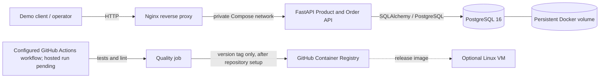

# Architecture and design notes

## Runtime layout

The public Compose port is bound to `127.0.0.1:8080` by default. For a VM, a host Nginx installation can terminate HTTPS and proxy to this local port. The API and database have no public host ports; they communicate on the private Compose network.

## Checkout and consistency

Order creation normalizes repeated product lines, locks product rows in ascending ID order on PostgreSQL, validates active state and stock, records the current price/name/SKU in order items, decrements stock, and writes the order in one transaction. Each order requires an `Idempotency-Key`. A canonical request hash lets an exact retry replay the first response while rejecting reuse of that key for different order contents. A database uniqueness constraint closes the concurrent duplicate-request race; a losing transaction rolls back its stock changes.

The automated tests use SQLite for a fast self-contained run. SQLite does not implement PostgreSQL row-level `FOR UPDATE` locking, so the local tests verify functional and transaction outcomes but do not prove concurrent checkout behavior. The Docker Compose deployment uses PostgreSQL, where those locks apply.

## Security boundaries

- Admin product changes, order status changes, and audit reads require `X-Admin-Token`.
- Compare tokens with a constant-time comparison; never log the token.
- Compose requires explicit non-empty `ADMIN_TOKEN` and `POSTGRES_PASSWORD` values; it has no fallback credentials.
- Passwords are assembled into the PostgreSQL URL through SQLAlchemy's URL builder, so punctuation in a secret is encoded correctly.
- API/database ports stay inside Compose; Nginx is the only published service.
- The API image runs as a non-root user and reads configuration from environment variables.
- The Python base image is pinned by digest. Debian packages are upgraded from live repositories during a build, so the resulting OS package set can change over time.
- The final runtime omits setuptools. A narrowly scoped, expiring Trivy exception covers only the stale setuptools 70.3.0 base-layer record; the strict scan also reports Debian high-severity findings without a fix version. See the verification report and scan evidence.
- TLS certificates and deployment secrets are intentionally external to the repository.

## Recovery model

The PostgreSQL named volume preserves data across normal container replacement. Its identity was checked before and after the local API image rebuild. `scripts/backup.ps1` creates a custom-format dump; `scripts/restore.ps1` replaces matching objects only after an explicit `-ConfirmRestore` flag. The isolated PostgreSQL tmpfs backup/restore rehearsal and the Nginx outage/recovery drill passed; evidence is in `docs/evidence/`. CI is configured to publish version and commit tags on `vX.Y.Z`, but the hosted workflow has not run because no GitHub remote exists. A previous version can be selected by changing `IMAGE_TAG` and recreating the API container.
